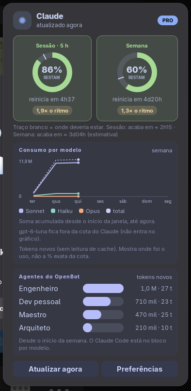
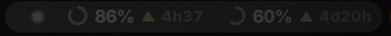
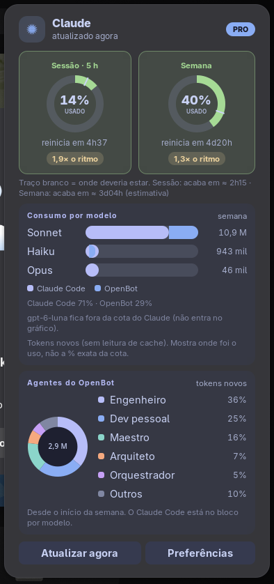

# Claude Usage Indicator

Extensão do **GNOME Shell** que mostra o uso do **Claude Code** na barra superior:
quanto **resta** da sessão de 5 h e da semana, em quanto tempo reseta, se o ritmo
vai estourar a cota e **onde foi o consumo** (por modelo e por agente do OpenBot).



> **Mesma fonte que o `/usage` do Claude Code.** Lê os percentuais direto do
> claude.ai (`GET /api/oauth/usage`) com o token OAuth que o Claude Code já guarda
> em `~/.claude/.credentials.json`. Esse endpoint só devolve estatísticas — **não
> consome tokens**.

---

## Novidades da 3.0

- **Anéis que esvaziam**: como no OpenBot, o anel mostra o que **resta** (verde → amarelo → vermelho). Dá para trocar para "usado" nas preferências.
- **Ritmo**: compara o que você usou com o que seria esperado se o uso fosse uniforme. `▲` aparece quando o ritmo passa de 1,2× **e** a projeção esgota a cota antes do reset (é uma estimativa linear).
- **Consumo por modelo** (Sonnet, Haiku, Opus) em gráfico **acumulado** ou lista, com a parte do Claude Code e a do OpenBot.
- **Agentes do OpenBot** em lista ou rosca.
- **Cores por estado dentro do card** (nunca a cor de destaque): atenção com ≤ 30% restante, crítico com ≤ 10% (configurável).
- **Contagem de tokens sem duplicatas**: o Claude Code grava a mesma mensagem em várias linhas; cada `message.id` é contado **uma vez** (sem isso o consumo saía ~62% inflado).
- Lógica pura em `logic.js` com testes em Node, backend com testes em Python, `make check` completo.

---

## Barra superior

Formato escolhido nas preferências:

| Formato | Exemplo |
|---|---|
| **Anéis** (padrão) — anel + valor + reset, `▲` quando o ritmo estoura |  |
| **Completo** — percentual + countdown |  |
| **Compacto** — só percentual |  |
| **Barras** — ícones de progresso |  |

No formato de anéis, `86% 4h38` é o restante da sessão e o tempo até o reset; `60% ▲ 4d21h` é a semana, com alerta de ritmo.
Os dois anéis seguem a cor do pior estado.

## O popup

- **Sessão (5 h) e Semana**: anel, valor, reset e o ritmo (`1,3× o ritmo`).
- **Consumo por modelo**: gráfico acumulado ao longo da janela (sessão ou semana) ou lista com Claude Code × OpenBot.
- **Agentes** do OpenBot: os que mais consumiram, em lista ou rosca.



> Os tokens contados são **saída + criação de cache + entrada não cacheada**. Isso mostra *onde* foi o uso; a cota do plano não é proporcional a tokens e o peso de cada modelo não é público. Modelos fora do Claude (ex.: GPT no OpenBot) ficam fora da conta.

---

## Preferências

`gnome-extensions prefs claude-usage@eltobsjr.gmail.com` ou menu da extensão → Preferências.

- **Exibição** — formato da barra, posição (seletor visual), ícone, intervalo de atualização, mostrar restante/usado, mostrar reset e ritmo.
- **Consumo** — mostrar modelos e agentes, modo (gráfico/lista, lista/rosca) e janela (sessão/semana).
- **Alertas** — limites de atenção e crítico (restante %), sempre com crítico < atenção.
- **Ticker** — inicia a sessão de 5 h sozinho (veja abaixo).
- **Sobre**.

Chaves GSettings: `refresh-interval`, `show-icon`, `label-format`, `value-mode`, `show-reset`, `show-pace`, `models-visible`, `models-mode`, `models-window`, `agents-visible`, `agents-mode`, `warn-at`, `crit-at`, `panel-position`, `ticker-enabled`, `ticker-time`, `ticker-days`, `ticker-continuous`, `ticker-until`, `ticker-last-fired`.

## Ticker (iniciar a sessão de 5 h sozinho)

A janela de 5 h só começa quando você manda a primeira mensagem. Com o ticker ligado (é o padrão; dá para desligar em Preferências → Ticker), no horário escolhido a extensão roda `claude -p ok --model haiku` (sem ferramentas, hooks, plugins nem histórico: cerca de 600 tokens) para a sessão começar — e reiniciar — mais cedo.

Por padrão vale **todos os dias** e fica em modo **contínuo**: a partir do primeiro tick do dia, sempre que a sessão acaba ele abre outra na hora, até o horário final (padrão 23:00). Desligando o contínuo, é uma vez por dia (recupera em até 2 h se o PC estava desligado).

Só dispara se: o dia está marcado, o horário já passou, os dados de uso estão frescos, **não há sessão ativa** e a semana não está esgotada. Nunca repete em menos de 1 h e, se a mensagem não abrir a janela, tenta só mais uma vez e avisa (não vira laço); se falhar, tenta de novo após 30 min. Precisa do `claude` instalado e logado. Só roda enquanto a sessão do GNOME está aberta.

### Com o PC desligado (rotina na nuvem)

A extensão só age com a sessão do GNOME aberta. Para cobrir o PC desligado, crie uma rotina agendada do Claude Code (`/schedule`, ou https://claude.ai/code/routines): cron `0 9,15,21 * * *` (06h, 12h e 18h em UTC-3), modelo Haiku, sem repositório nem conectores, prompt `Responda apenas: ok. Não use ferramentas, não leia nem edite arquivos.`

Os dois se completam, não se repetem: a extensão é exata (reage ao fim real da sessão), mas depende do PC ligado; a nuvem é cega (horário fixo, mínimo de 1 h entre execuções), mas roda sempre. Se a nuvem dispara com a sessão já ativa, só manda um "ok" a mais dentro dela. O espaço é de 6 h, e não de 5 h, de propósito: o disparo tem alguns minutos de atraso e, caindo antes da sessão acabar, não abriria a seguinte.

## Posição na barra

O seletor de posição tem uma mini barra interativa que mostra onde o indicador ficará:

| Opção | Resultado na barra |
|---|---|
| **Borda esquerda** |  |
| **Esquerda** |  |
| **Direita** | Imediatamente à esquerda dos ícones nativos (volume, rede, bateria, menu) |

> Os ícones nativos do GNOME ficam sempre fixos na direita — extensões não podem
> ultrapassá-los. A opção **Direita** coloca o indicador logo à esquerda deles.

A posição é aplicada ao vivo ao mudar — sem precisar reiniciar a extensão.

---

## Visual

O tema (paleta e cor de destaque) é escolhido no `./install.sh` e vale para as barras de progresso, rótulos e avisos. Veja [Tema e opções](#tema-e-opções-escolhidos-na-instalação).

---

## Requisitos

- GNOME Shell 45–50
- `python3`
- Claude Code instalado e em uso (é a fonte dos dados)

---

## Instalação

```bash
git clone https://github.com/eltobsjr/claudeUsageIndicator.git
cd claudeUsageIndicator
./install.sh
gnome-extensions enable claude-usage@eltobsjr.gmail.com
```

No **Wayland** é preciso fazer **logout/login** após instalar para o GNOME Shell
recarregar as extensões. No **X11**, basta `Alt+F2` → `r` → Enter.

### Via Makefile

```bash
make install   # copia e compila o schema
make enable    # ativa a extensão
make run       # roda o tracker e imprime o resumo no terminal
make check     # sintaxe, schema, temas, contraste, testes Python e Node
make pack      # gera o .zip para o extensions.gnome.org
```

---

### Tema e opções (escolhidos na instalação)

O `./install.sh` pergunta no terminal, antes de copiar qualquer coisa:

- **Paleta**: Catppuccin Macchiato (padrão), Frappé ou Mocha, com uma prévia em cores.
- **Cor de destaque**: 12 opções, ou **seguir o destaque do GNOME** (47+).
- **Opções da extensão**: posição, formato do texto na barra, ícone e intervalo de atualização.

Nenhuma cor fica escrita no código: o `stylesheet.css` é gerado na instalação a partir da paleta que você escolheu.
Para refazer as escolhas, rode `./install.sh --reconfigure`. Sem terminal (CI, `curl | bash`) ou com `--yes`,
vale o que já estava salvo ou o padrão. Também aceita `--palette macchiato|frappe|mocha`, `--accent blue|mauve|…` e `--system-accent`.
Detalhes do padrão visual em [`docs/DESIGN.md`](docs/DESIGN.md).

## Como funciona

A extensão dispara um pequeno script Python (`claude-usage-tracker.py`) que:

1. Lê o token OAuth de `~/.claude/.credentials.json`,
2. Consulta **% de uso, severidade e horários de reset** via
   `GET /api/oauth/usage` do claude.ai (endpoint de estatísticas — não consome
   tokens),
3. **Cacheia** a resposta e respeita o `retry-after` do rate-limit, servindo o
   último valor bom (marcado como desatualizado) em caso de falha,
4. Calcula o **consumo** (`consumption.py`): lê de forma incremental os registros do Claude Code (`~/.claude/projects/**/*.jsonl`, com cache por arquivo e deduplicação por `message.id`) e, **só para leitura**, a tabela de uso do OpenBot,
5. Grava tudo em `~/.local/share/claude-usage/usage.json`.

A extensão lê esse JSON e desenha a interface; a lógica de decisão (nível, ritmo, textos) fica em `logic.js`. O intervalo de atualização da UI
é independente da chamada HTTP real — você pode atualizar a tela com frequência
sem martelar a API.

Você também pode usar o tracker sozinho, sem a extensão:

```bash
python3 extension/claude-usage-tracker.py --print
python3 extension/claude-usage-tracker.py --watch 30   # loop a cada 30s
CLAUDE_USAGE_DEMO=1 python3 extension/claude-usage-tracker.py --print   # dados fictícios (para prints)
```

---

## Estrutura

```
claude-usage-indicator/
├── extension/
│   ├── extension.js                 # interface: barra, popup, anéis, gráficos
│   ├── logic.js                     # lógica pura (nível, ritmo, textos, séries)
│   ├── prefs.js                     # preferências (libadwaita)
│   ├── consumption.py               # consumo por modelo/agente (incremental)
│   ├── claude-usage-tracker.py      # consulta OAuth + cache/back-off + resumo
│   ├── stylesheet.tpl.css           # modelo do estilo (tokens da paleta)
│   ├── metadata.json
│   ├── icons/claude-symbolic.svg
│   └── schemas/*.gschema.xml
├── tests/
│   ├── logic.test.mjs               # node --test
│   └── test_consumption.py          # pytest
├── docs/                            # screenshots e DESIGN.md
├── install.sh
├── Makefile
├── LICENSE
└── README.md
```

---

## Notas

- O consumo por modelo/agente é estimativa local (tokens), não a cota oficial.
- A **% de uso** da sessão e da semana vem diretamente da Anthropic via OAuth —
  é o mesmo número que o comando `/usage` do Claude Code mostra.
- O endpoint `/api/oauth/usage` é interno do Claude Code e **não é documentado**;
  pode mudar sem aviso. Se isso acontecer, o indicador mostra "—" em vez de erro.

---

## Licença

MIT — veja [LICENSE](LICENSE).
